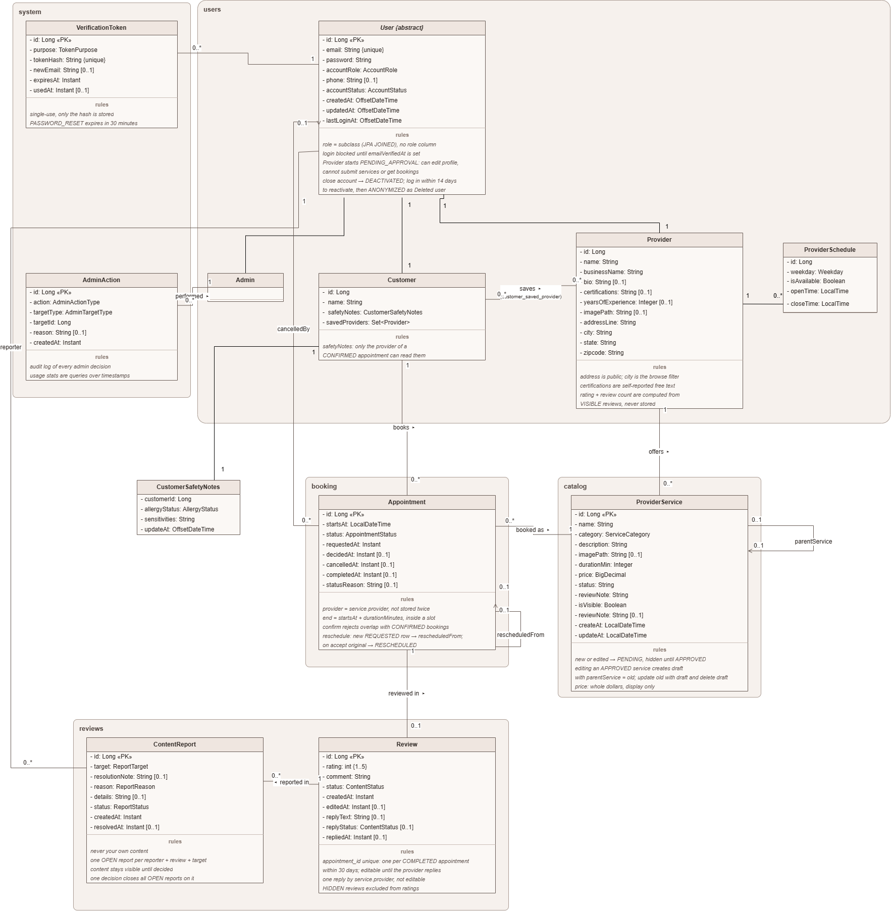

# GlowUp backend API

# UML Class Diagram



# API Overview

**Version:** 1.0
**Last Updated:** October 23, 2026

**Base URL:**

- local: http://localhost:8080/api
- production: https://glow-up-api.onrender.com/api

JSON request bodies are validated. The endpoint tables list applicable error
code: `400 Bad Request` for invalid input, `404 Not Found` for missing
resources, and `409 Conflict` for duplicate records or invalid state
transitions.

## Profile and discovery

| Method | Path                            | Purpose                                                    | Response code | Error codes | User story                                                              |
| ------ | ------------------------------- | ---------------------------------------------------------- | ------------- | ----------- | ----------------------------------------------------------------------- |
| POST   | `/api/customers/register`       | Register a customer profile                                | `201 Created` | `400, 409` | [US-1](../docs/GlowUpSRS.md) |
| GET    | `/api/customers/{id}`           | Read a customer profile                                    | `200 OK`      | `404`        | [US-1](../docs/GlowUpSRS.md) |
| PUT    | `/api/customers/{id}`           | Update a customer profile (name, email, phone number)      | `200 OK`      | `400, 404, 409`   | [US-1](../docs/GlowUpSRS.md) |
| PUT    | `/api/customers/{id}/password`  | Change the password (current password required)            | `204 No Content` | `400, 404`       | [US-1](../docs/GlowUpSRS.md) |
| PUT    | `/api/customers/{id}/safety-notes` | Set allergy and sensitivity notes                       | `200 OK` | `400, 404`      | [US-1](../docs/GlowUpSRS.md) |
| GET    | `/api/customers/{id}/saved-providers` | List the customer's saved providers                  | `200 OK` | `404`             | [US-1](../docs/GlowUpSRS.md) |
| PUT    | `/api/customers/{id}/saved-providers/{providerId}` | Save a provider                         | `204 No Content` | `404`     | [US-1](../docs/GlowUpSRS.md) |
| DELETE | `/api/customers/{id}/saved-providers/{providerId}` | Remove a saved provider                 | `204 No Content` | `404`     | [US-1](../docs/GlowUpSRS.md) |
| GET    | `/api/customers/browse` | Browse providers and their approved services by category, city, day, time of day, keyword, saved providers, and sort | `200 OK` | `400`, `404` | [US-2](../docs/GlowUpSRS.md) |
| POST   | `/api/customers/{customerId}/appointments` | Request an appointment for an approved service  | `201 Created` | `400, 404` | [US-3](../docs/GlowUpSRS.md) |
| `POST` | `/api/providers/register`                | Register a provider profile with starting opening hours    | `201 Created` | `400, 409`  | [US-5](../docs/GlowUpSRS.md#L115) |
| `GET`  | `/api/providers/{providerId}`   | Read a provider's public profile (ACTIVE providers only)   | `200 OK`      | `404`       | [US-5](../docs/GlowUpSRS.md#L115) |
| `GET`  | `/api/providers/{providerId}/profile` | Provider reads their own profile in any status       | `200 OK`      | `404`       | [US-5](../docs/GlowUpSRS.md#L115) |
| `PUT`  | `/api/providers/{providerId}`   | Update a provider profile                                  | `200 OK`      | `400, 404, 409` | [US-5](../docs/GlowUpSRS.md#L115) |


## Example Customer Request

```http
POST /api/customers/register
Content-Type: application/json

{
  "name": "Jane Rob",
  "email": "jane.rob@example.com",
  "password": "securePassword123",
  "phoneNumber": "336-555-0101"
}
```

### Example Provider Request

```http
POST /api/providers/register
Content-Type: application/json

{
  "email": "alice@example.com",
  "password": "securePassword123",
  "phoneNumber": "555-8492",
  "name": "Alice Johnson",
  "bio": ".",
  "certifications": "Certified specialist with over 5 years of professional experience in nail care.",
  "yearsOfExperience": 5,
  "imagePath": "../images/alice.jpg",
  "addressLine": "456 West Boulevard, Suite 200",
  "city": "Greensboro",
  "state": "NC",
  "zipcode": "27408",
  "availableDays": ["MONDAY", "TUESDAY", "THURSDAY", "FRIDAY", "SATURDAY"],
  "openTime": "08:00:00",
  "closeTime": "16:00:00"
}
```

### Password storage
Passwords are accepted only by registration endpoints, hashed with BCrypt, and
never included in API responses. Authentication and authorization are not yet
implemented; IDs in paths are not proof of identity and these endpoints must not
be exposed to untrusted clients until access control is added. Login, access
control, and email notifications are planned for the next milestone.

## Services and availability

| Method   | Path                                                     | Purpose                                                             | Response code    | Error codes | User story                          |
| -------- | -------------------------------------------------------- | ------------------------------------------------------------------- | ---------------- | ----------- | ----------------------------------- |
| `GET` | `/api/providers/{providerId}/services`                        | List that provider's approved and visible services                              | `200 OK`      | `404`  | [US-6](../docs/GlowUpSRS.md#L130) |
| `GET` | `/api/providers/{providerId}/all-services`                    | List all of that provider's services in every status (My services page)         | `200 OK`      | `404`  | [US-6](../docs/GlowUpSRS.md#L130) |
| `POST` | `/api/providers/{providerId}/services`                       | Create a service; it is PENDING and hidden until an admin approves it           | `201 Created` | `400, 403, 404`  | [US-6](../docs/GlowUpSRS.md#L130) |
| `PUT`  | `/api/providers/{providerId}/services/{serviceId}`           | Edit a service; an approved one gets a draft and keep stays visible             | `200 OK`      | `400, 403, 404, 409` | [US-6](../docs/GlowUpSRS.md#L138) |
| `PATCH` | `/api/providers/{providerId}/services/{serviceId}/archive`  | Stop offering a service (or withdraw a submission); open requests are declined  | `200 OK`      | `404, 409`| [US-6](../docs/GlowUpSRS.md#L143) |
| `GET` | `/api/providers/{providerId}/schedules?availableOnly=false`   | List the weekly opening hours                                                   | `200 OK`      | `404`     | [US-7](../docs/GlowUpSRS.md#L152) |
| `PUT` | `/api/providers/{providerId}/schedules`                       | Update the weekly opening hours (one or more weekdays)                          | `200 OK`      | `400, 404`| [US-7](../docs/GlowUpSRS.md#L152) |

### Example Service Request

```http
POST /api/providers/{providerId}/services
Content-Type: application/json
NOTE: Provider account's status has to be ACTIVE to create or update a service (otherwise 403)

{
	"name": "Eyebrows waxing",
	"description": "Eyebrow shaping and waxing using professional wax and soothing post-wax lotion.",
	"price": 15,
	"category": "BROWS_AND_LASHES",
	"durationMin": 10,
    "imagePath":"../images/design.jpg"
}
```

### Example Provider Update Schedule Request
Send the weekdays to change, each at most once; days not sent stay as they are. Times are in 15-minute steps.
A closed day may leave the times out, and then the saved times are kept for when it reopens.
```http
PUT /api/providers/{providerId}/schedules
Content-Type: application/json

{
  "providerDailySchedule": [
    {
      "weekday": "MONDAY",
      "isAvailable": true,
      "openTime": "09:00:00",
      "closeTime": "17:00:00"
    },
    {
      "weekday": "TUESDAY",
      "isAvailable": true,
      "openTime": "09:00:00",
      "closeTime": "17:00:00"
    },
    {
      "weekday": "WEDNESDAY",
      "isAvailable": true,
      "openTime": "09:00:00",
      "closeTime": "17:00:00"
    },
    {
      "weekday": "THURSDAY",
      "isAvailable": true,
      "openTime": "09:00:00",
      "closeTime": "17:00:00"
    },
    {
      "weekday": "FRIDAY",
      "isAvailable": true,
      "openTime": "09:00:00",
      "closeTime": "19:30:00"
    },
    {
      "weekday": "SATURDAY",
      "isAvailable": true,
      "openTime": "10:00:00",
      "closeTime": "15:00:00"
    },
    {
      "weekday": "SUNDAY",
      "isAvailable": false,
      "openTime": null,
      "closeTime": null
    }
  ]
}
```

## Appointments and reviews

| Method  | Path                                                          | Purpose                                               | Response code | Error codes | User story                                                              |
| ------- | ------------------------------------------------------------- | ----------------------------------------------------- | ------------- | ----------- | ----------------------------------------------------------------------- |
| `POST` | `/api/customers/{customerId}/appointments`                            | Customer request an appointment; REQUESTED status by default                             | `201 Created` | `400, 403, 404`  |  [US-3](../docs/GlowUpSRS.md#L75) |
| `GET` | `/api/providers/{providerId}/appointments`                            | List the provider's all appointments                               | `200 OK` | `404`  | [US-7](../docs/GlowUpSRS.md#L158) |
| `GET` | `/api/providers/{providerId}/appointments/{appointmentId}`            | View an appointment's detail; customer's contact info and safety notes show only with CONFIRMED appointments | `200 OK` | `404`  | [US-7](../docs/GlowUpSRS.md#L165) |
| `PATCH` | `/api/providers/{providerId}/appointments/{appointmentId}/confirm`  | Confirm a REQUESTED appointment (or accept a new time)          | `200 OK` | `400, 404, 409`  | [US-7](../docs/GlowUpSRS.md#L158) |
| `PATCH` | `/api/providers/{providerId}/appointments/{appointmentId}/decline`  | Decline a REQUESTED appointment, with a reason                                | `200 OK` | `400, 404, 409`  | [US-7](../docs/GlowUpSRS.md#L158) |
| `PATCH` | `/api/providers/{providerId}/appointments/{appointmentId}/cancel`   | Cancel a CONFIRMED appointment before it starts, with a reason  | `200 OK` | `400, 404, 409`  | [US-7](../docs/GlowUpSRS.md#L158) |
| `PATCH` | `/api/providers/{providerId}/appointments/{appointmentId}/complete` | Mark a CONFIRMED appointment COMPLETED after it ends            | `200 OK` | `404, 409`  | [US-7](../docs/GlowUpSRS.md#L158) |

### Example Appointment Request
```http
POST /api/customers/{customerId}/appointments
{
  "serviceId": 1,
  "startDateTime":"2026-11-05T10:00:00"
}
```

## Reviews and reports

A customer can review their own completed appointment within 30 days of it ending, once per appointment, and edit the review until the provider replies. A provider can reply once and cannot edit the reply. Hidden reviews do not count toward a provider's rating and hidden replies are not shown. Anyone can report someone else's review or reply (providers: reviews of their own services); one open report per person per item.

| Method | Path | Purpose | Response code | Error codes | User story |
| ------ | ---- | ------- | ------------- | ----------- | ---------- |
| `POST` | `/api/customers/{customerId}/appointments/{appointmentId}/review` | Review a completed appointment (rating 1–5 and a comment) | `201 Created` | `400, 403, 404, 409` | [US-4](../docs/GlowUpSRS.md#L97) |
| `PUT` | `/api/customers/{customerId}/reviews/{reviewId}` | Edit own review (only before the provider replies) | `200 OK` | `400, 403, 404, 409` | [US-4](../docs/GlowUpSRS.md#L97) |
| `GET` | `/api/customers/{customerId}/reviews` | List the customer's own reviews | `200 OK` | `404` | [US-4](../docs/GlowUpSRS.md#L97) |
| `GET` | `/api/providers/{providerId}/reviews` | Provider reviews page: average rating, review count, and visible reviews | `200 OK` | `404` | [US-4](../docs/GlowUpSRS.md#L97) |
| `POST` | `/api/providers/{providerId}/reviews/{reviewId}/reply` | Reply to a review of the provider's service (once) | `201 Created` | `400, 403, 404, 409` | [US-8](../docs/GlowUpSRS.md#L171) |
| `POST` | `/api/customers/{customerId}/reports` | Report a review or reply | `201 Created` | `400, 403, 404, 409` | [US-4](../docs/GlowUpSRS.md#L97) |
| `POST` | `/api/providers/{providerId}/reports` | Report a review of the provider's own service | `201 Created` | `400, 403, 404, 409` | [US-8](../docs/GlowUpSRS.md#L171) |

### Example Review Request

```http
POST /api/customers/1/appointments/5/review
Content-Type: application/json

{
  "rating": 5,
  "comment": "Great gel manicure, lasted three weeks."
}
```

### Example Reply Request

```http
POST /api/providers/3/reviews/1/reply
Content-Type: application/json

{ "text": "Thank you, see you next time!" }
```

### Example Report Request

`target` is `REVIEW` (default) or `REPLY`. `reason` is `HARASSMENT`, `THREATS`, `HATE_OR_EXPLICIT`, `PERSONAL_INFORMATION`, `SPAM`, or `OFF_TOPIC`.

```http
POST /api/customers/2/reports
Content-Type: application/json

{
  "reviewId": 1,
  "target": "REVIEW",
  "reason": "SPAM",
  "details": "Advertises another salon."
}
```

## Admin

Every admin request sends the admin's account id in the `X-Admin-Id` header until login is added (`403` otherwise).
Every decision needs a reason and is written to the admin audit log.

| Method | Path | Purpose | Response code | Error codes | User story |
| ------ | ---- | ------- | ------------- | ----------- | ---------- |
| `GET` | `/api/admin/users?status=&role=&q=&page=0&size=20` | List and search accounts | `200 OK` | `400, 403` | [US-9](../docs/GlowUpSRS.md#L187) |
| `GET` | `/api/admin/users/{userId}` | View an account | `200 OK` | `403, 404` | [US-9](../docs/GlowUpSRS.md#L187) |
| `GET` | `/api/admin/users/{userId}/actions` | Admin decisions on an account | `200 OK` | `403, 404` | [US-9](../docs/GlowUpSRS.md#L187) |
| `POST` | `/api/admin/users/{userId}/approve` | Approve a provider waiting for approval | `200 OK` | `400, 403, 404, 409` | [US-9](../docs/GlowUpSRS.md#L187) |
| `POST` | `/api/admin/users/{userId}/suspend` | Suspend an account; its upcoming requested and confirmed appointments are cancelled | `200 OK` | `400, 403, 404, 409` | [US-9](../docs/GlowUpSRS.md#L187) |
| `POST` | `/api/admin/users/{userId}/reinstate` | Reinstate a suspended account | `200 OK` | `400, 403, 404, 409` | [US-9](../docs/GlowUpSRS.md#L187) |
| `GET` | `/api/admin/services?status=&q=&page=0&size=20` | List and search services | `200 OK` | `400, 403` | [US-10](../docs/GlowUpSRS.md#L201) |
| `GET` | `/api/admin/services/{serviceId}` | View a service | `200 OK` | `403, 404` | [US-10](../docs/GlowUpSRS.md#L201) |
| `GET` | `/api/admin/services/{serviceId}/actions` | Admin decisions on a service | `200 OK` | `403, 404` | [US-10](../docs/GlowUpSRS.md#L201) |
| `POST` | `/api/admin/services/{serviceId}/decision` | Approve, request changes, or reject a PENDING service | `200 OK` | `400, 403, 404, 409` | [US-10](../docs/GlowUpSRS.md#L201) |
| `POST` | `/api/admin/services/{serviceId}/archive` | Take down a live (approved) service; the reason is shown to the provider | `200 OK` | `400, 403, 404, 409` | [US-10](../docs/GlowUpSRS.md#L210) |
| `GET` | `/api/admin/reviews?hiddenOnly=false` | Reviews with open reports (or, with `hiddenOnly=true`, with hidden content) | `200 OK` | `403` | [US-11](../docs/GlowUpSRS.md#L216) |
| `GET` | `/api/admin/reviews/{reviewId}` | A review and its reply with all reports and decisions | `200 OK` | `403, 404` | [US-11](../docs/GlowUpSRS.md#L216) |
| `POST` | `/api/admin/reviews/{reviewId}/decision` | Keep visible, hide, or restore the review or its reply; resolves its open reports | `200 OK` | `400, 403, 404, 409` | [US-11](../docs/GlowUpSRS.md#L216) |
| `GET` | `/api/admin/stats?from=&to=` | Usage statistics for a period (at most 24 months) | `200 OK` | `400, 403` | [US-12](../docs/GlowUpSRS.md#L231) |

```http
POST /api/admin/services/{serviceId}/archive
X-Admin-Id: 1
Content-Type: application/json

{ "reason": "The photos are not of the provider's own work." }
```

```http
POST /api/admin/reviews/{reviewId}/decision
X-Admin-Id: 1
Content-Type: application/json

{ "target": "REVIEW", "decision": "HIDE", "reason": "Contains the provider's home address." }
```
